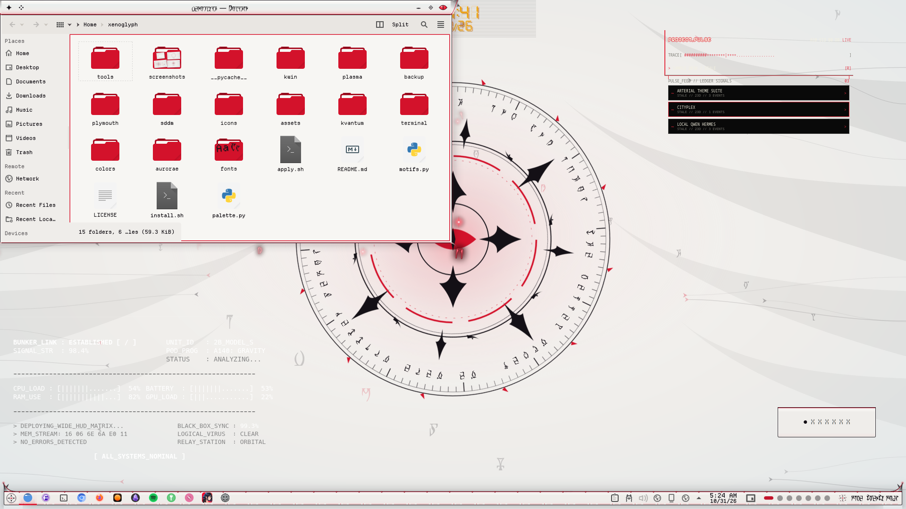

# Xenoglyph — Unfurl (KWin Effect)

Windows open like an eye: a ragged, ink-rimmed slit with a red glow widens to uncover them, and shuts when they close.



Xenoglyph is an alien-white, cybertribal look for KDE Plasma 6: pearl and bone surfaces, black tribal ink that sweeps into fins, horns and claws, a red ichor seam through everything, Daedric script, and motion everywhere.

## Features

- Open: a horizontal slit with a torn ink rim and a red glow tears across the window and widens until it is uncovered.
- Close: the same eye shuts over the window.
- One small GLSL shader on the GPU. Durations are configurable (`OpenDuration`, `CloseDuration` in ms) and follow Plasma's animation speed.


## Requirements

KWin (Plasma 6), OpenGL compositing.

## Install

```bash
git clone https://github.com/numbpill3d/xenoglyph-unfurl
cd xenoglyph-unfurl && ./install.sh
```

Or from the KDE Store: Extract to `~/.local/share/kwin/effects/`, then enable **Xenoglyph Unfurl** in System Settings → Window Management → Desktop Effects (turn off other open/close animations).

## The rest of the suite

| piece | repo |
|---|---|
| SDDM login | [xenoglyph-sddm](https://github.com/numbpill3d/xenoglyph-sddm) |
| Plymouth boot splash | [xenoglyph-plymouth](https://github.com/numbpill3d/xenoglyph-plymouth) |
| Global theme + splash screen | [xenoglyph-global](https://github.com/numbpill3d/xenoglyph-global) |
| Plasma style (panel, popups) | [xenoglyph-plasma](https://github.com/numbpill3d/xenoglyph-plasma) |
| Aurorae window decoration | [xenoglyph-aurorae](https://github.com/numbpill3d/xenoglyph-aurorae) |
| Floating runes (KWin script) | [xenoglyph-runes](https://github.com/numbpill3d/xenoglyph-runes) |
| Animated + still wallpaper | [xenoglyph-wallpaper](https://github.com/numbpill3d/xenoglyph-wallpaper) |
| Sigil clock widget | [xenoglyph-sigil](https://github.com/numbpill3d/xenoglyph-sigil) |
| Colour scheme | [xenoglyph-colors](https://github.com/numbpill3d/xenoglyph-colors) |
| Kvantum widget style | [xenoglyph-kvantum](https://github.com/numbpill3d/xenoglyph-kvantum) |
| Icon theme | [xenoglyph-icons](https://github.com/numbpill3d/xenoglyph-icons) |
| Konsole + kitty colours | [xenoglyph-konsole](https://github.com/numbpill3d/xenoglyph-konsole) |

Everything at once, with the generators: [xenoglyph](https://github.com/numbpill3d/xenoglyph).

## Tags

`xenoglyph` `kde` `kde-plasma` `plasma6` `light-theme` `white` `red` `cybertribal` `tribal` `alien` `daedric` `otherworldly` `animated` `kwin-effect` `kwin` `animation` `glsl` `window-animation`

## Credits and licence

By splicer scorn (voidrane). GPL-3.0-or-later.
Shader harness adapted from Burn-My-Windows by Simon Schneegans (GPL-3.0).
